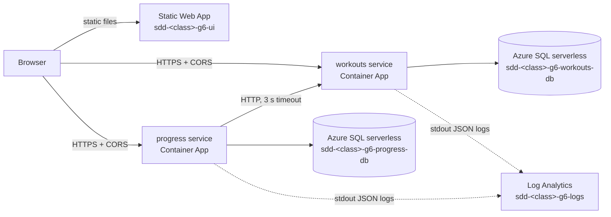

# LiftLog

Log your lifts and get told what to lift next time. LiftLog stores your workouts
(exercises, sets, weight, reps), detects personal records automatically, tracks goals,
and recommends the next session's weight with a progressive-overload rule.

**Live:** _UI URL goes here after the first deploy_ · **Status:** Sprint 1, skeleton

## Architecture



- **workouts** (`services/workouts`): exercises, workouts and sets. Source of truth for what you lifted.
- **progress** (`services/progress`): goals, personal records and next-session recommendations.
  Reads workout history from workouts over HTTP. If workouts is down, progress answers
  503 with a readable message instead of hanging.
- **ui** (`ui/`): plain HTML/JS, calls both services from the browser.

Why two services and why this shape: [docs/decisions.md](docs/decisions.md).

## Run locally

Needs Docker. From a clean clone:

```bash
cp .env.example .env    # then fill in the three passwords
docker compose up --build
```

UI http://localhost:8080 · workouts http://localhost:8001/docs · progress http://localhost:8002/docs

Partial failure: `docker compose stop workouts`, and progress keeps answering.

## Run the tests

Tests run against a real SQL Server (the one in compose). Per service:

```bash
docker compose up -d sqlserver
cd services/workouts            # or services/progress
python -m venv .venv && source .venv/bin/activate
pip install -r requirements-dev.txt
TEST_DATABASE_URL="mssql://sa:<SA_PASSWORD>@localhost:1433/liftlog_test_workouts" python -m pytest
ruff check . && ruff format --check .
```

Coverage must stay at or above 70% (set in each `pyproject.toml`; CI fails below it).

## Pipeline

`.github/workflows/pipeline.yml`:

- **Every PR and push:** ruff lint + format check, tests with coverage against a throwaway
  SQL Server, `pip-audit`, a gitleaks scan of the whole history, and an image build.
- **Merge to main:** the same, then images pushed to GHCR tagged with the commit SHA,
  both Container Apps updated, the UI deployed to Static Web Apps, and `/health` polled
  until it reports the new SHA (fails the run after 5 minutes).

## Reproduce the Azure setup

Everything is in `infra/main.bicep`. One member, logged in with `az login`:

```bash
CLASS=<class> SQL_ADMIN_PASSWORD='<strong password>' IMAGE_TAG=<sha on GHCR> infra/setup.sh
```

Then in GitHub > Settings > Secrets and variables > Actions set variables
`AZURE_RESOURCE_GROUP`, `AZURE_PREFIX` and the secret `AZURE_CREDENTIALS` (the group's
service principal). The deploy job is skipped until `AZURE_PREFIX` exists.

## Secrets

None in the repository. Locally they live in `.env` (gitignored); in Azure they are
Container App secrets set by Bicep; in CI they are GitHub secrets. If one leaks: revoke or
rotate it first, then remove it, then tell the professor (Assignment 2 §5).

## Monitoring

Queries for the dashboard (request count, error rate, response time) and the SLO are in
[monitoring/queries.kql](monitoring/queries.kql).

## Team

| Name | GitHub | Owns |
|---|---|---|
| _name_ | @_username_ | platform (CI/CD, Azure, monitoring) + progress service |
| _name_ | @_username_ | workouts service |
| _name_ | @_username_ | UI |

Scrum roles per sprint: [docs/scrum/](docs/scrum/).
