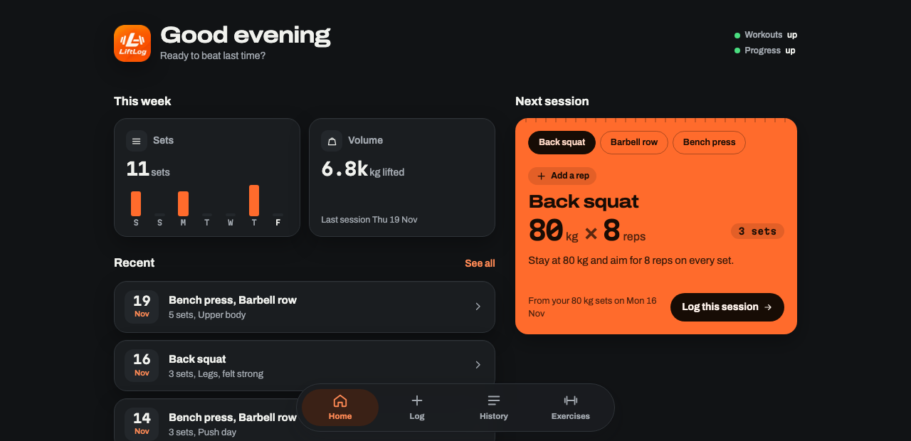
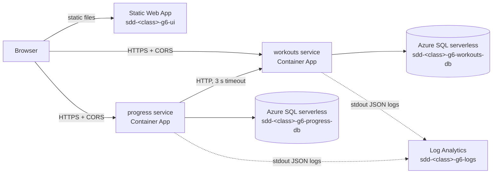

# LiftLog

Log your lifts and get told what to lift next time. LiftLog stores your workouts
(exercises, sets, weight, reps), detects personal records automatically, tracks goals,
and recommends the next session's weight with a progressive-overload rule.

**Live:** https://wonderful-grass-0928c6b03.6.azurestaticapps.net (the first request after a quiet period can take up to a minute while Azure wakes the services and databases) · **Status:** Sprint 2 (19–24 Nov 2026)



## Using LiftLog

The UI works on a phone (tab bar at the bottom) and on a desktop (two columns from 960px).

- **Exercises:** add the lifts you do, each with a body part (upper or lower) and a rep
  range, e.g. Bench press, upper body, 8–12 reps. You can edit them, and delete them while
  no workout uses them.
- **Log:** pick a date, add sets (exercise, kg, reps) and save. Saved workouts can be
  edited or deleted from History.
- **Home:** sets and volume for the last 7 days, your recent workouts, and the
  **next-session coach**: for each exercise it looks at your last session and tells you
  what to lift next time. If every set reached the top of the rep range it adds weight
  (+2.5 kg upper body, +5 kg lower body), if every set missed the bottom it drops about
  10%, otherwise it asks for one more rep. *Log this session* fills the Log form with
  that suggestion.
- **History:** every workout, newest first; open one to see its sets.
- **When a service is down:** the app says so in plain words and keeps working where it
  can, e.g. with the workouts service stopped you get a banner and a "Try again" button
  instead of a broken page.
- **Progress:** set goals such as *Bench press 65 kg × 8 by 19 Dec* and see how close you
  are (a bar, your best qualifying set, days left or "Achieved"), and see your **personal
  records**: the heaviest weight for each number of reps per exercise, with records set
  since your last look marked *New*. Goals still show while the workouts service is down.

## Architecture



- **workouts** (`services/workouts`): exercises, workouts and sets. Source of truth for what you lifted.
- **progress** (`services/progress`): goals, personal records and next-session recommendations.
  Reads workout history from workouts over HTTP. If workouts is down, progress answers
  503 with a readable message instead of hanging.
- **ui** (`ui/`): plain HTML/JS, calls both services from the browser.

Why two services and why this shape: [docs/decisions.md](docs/decisions.md).

## Run locally

Needs Docker. From a clean clone:

```bash
cp .env.example .env    # then fill in the three passwords
docker compose up --build
```

UI http://localhost:8080 · workouts http://localhost:8001/docs · progress http://localhost:8002/docs

Partial failure: `docker compose stop workouts`, and progress keeps answering.

## Run the tests

Tests run against a real SQL Server (the one in compose). Per service:

```bash
docker compose up -d sqlserver
cd services/workouts            # or services/progress
python -m venv .venv && source .venv/bin/activate
pip install -r requirements-dev.txt
TEST_DATABASE_URL="mssql://sa:<SA_PASSWORD>@localhost:1433/liftlog_test_workouts" python -m pytest
ruff check . && ruff format --check .
```

Coverage must stay at or above 70% (set in each `pyproject.toml`; CI fails below it).

## Pipeline

`.github/workflows/pipeline.yml`:

- **Every PR and push:** ruff lint + format check, tests with coverage against a throwaway
  SQL Server, `pip-audit`, a gitleaks scan of the whole history, and an image build.
- **Merge to main:** the same, then images pushed to GHCR tagged with the commit SHA,
  both Container Apps updated, the UI deployed to Static Web Apps, and `/health` polled
  until it reports the new SHA (fails the run after 5 minutes). Then
  `scripts/smoke_test.sh` creates an exercise and a workout on the live API, asks progress
  for the next session (so the call between the services is tested too), and deletes
  them again; any wrong answer fails the run. It also runs against `docker compose`:
  `WORKOUTS_URL=http://localhost:8001 PROGRESS_URL=http://localhost:8002 scripts/smoke_test.sh`.

## Reproduce the Azure setup

Everything is in `infra/main.bicep`. One member, logged in with `az login`:

```bash
CLASS=<class> SQL_ADMIN_PASSWORD='<strong password>' \
  WORKOUTS_DB_PASSWORD='<strong password>' PROGRESS_DB_PASSWORD='<strong password>' \
  IMAGE_TAG=<sha on GHCR> infra/setup.sh
```

The script deploys the Bicep and creates one database user per service
(`infra/sql/app-user.sql`); the services never connect as the SQL admin. It needs `sqlcmd`
or Docker, and briefly allows your own IP on the SQL firewall (removed when it ends).

Then in GitHub > Settings > Secrets and variables > Actions set variables
`AZURE_RESOURCE_GROUP`, `AZURE_PREFIX` and the secret `AZURE_CREDENTIALS` (the group's
service principal). The deploy job is skipped until `AZURE_PREFIX` exists.

## Secrets

None in the repository. Locally they live in `.env` (gitignored); in Azure they are
Container App secrets set by Bicep; in CI they are GitHub secrets. If one leaks: revoke or
rotate it first, then remove it, then tell the professor (Assignment 2 §5). A database
password is rotated by running `infra/setup.sh` again with a new value.

## Security model

- Each service has its own database user, in both compose and Azure, and cannot open the
  other service's database ([ADR-2](docs/decisions.md#adr-2-storage-and-database-access)).
- The APIs have **no sign-in, by design**: LiftLog is a single-user demo with test data.
  CORS stops other websites from calling them, but anyone with a service URL can use the
  API directly ([ADR-1](docs/decisions.md#adr-1-two-services-split-by-write-path-vs-analysis-with-no-user-accounts)).

## Monitoring

Each service logs one JSON line per request (method, path, status, duration; INFO level,
no request bodies) to stdout, which Container Apps sends to the Log Analytics workspace
`<prefix>-logs`. The queries in [monitoring/queries.kql](monitoring/queries.kql) are
deployed by Bicep as saved queries: in the Azure portal open the workspace, then
**Logs > Queries > LiftLog**.

- **Dashboard:** *1. Request count*, *2. Error rate (5xx)* and *3. Response time
  p50/p95/p99*, per service, as time charts. *6. Slowest endpoints* and *7. Recent
  errors* help when one of them looks wrong.
- **SLO:** **99% of GET requests to the workouts API are answered without a server error
  in under 500 ms, measured over a rolling 7 days.** *4. SLO* gives the SLI, whether the
  target is met and how much error budget is left; *5. SLO daily* shows the SLI per day.
  Cold starts (a Container App scaling up from zero, a database waking from auto-pause)
  count against the budget on purpose, because users feel them; they are the main way
  this SLO is missed on a demo with little traffic.

## Team

Class 3B, group 6.

| Name | GitHub | Built | Scrum roles |
|---|---|---|---|
| Raji | [@Liftitnium](https://github.com/Liftitnium) | Platform: CI/CD pipeline, Azure (Bicep), monitoring, smoke test. Workouts API (#9–#11) and the next-session coach (#12) | Scrum Master in Sprint 1, Product Owner in Sprint 2 |
| Emma | [@emmlje18](https://github.com/emmlje18) | UI (#13–#17, #22), README, Scrum records | Product Owner in Sprint 1, Scrum Master in Sprint 2 |
| David | [@DavidDumit](https://github.com/DavidDumit) | Goals (#21) and personal records (#20) in the progress service | Developer |
| Lorenzo | [@Hoffalo](https://github.com/Hoffalo) | Data model documentation (#24) | Developer |

Sprint records (planning, review, retrospective): [docs/scrum/](docs/scrum/). How we used
AI tools: [AI_USAGE.md](AI_USAGE.md).
