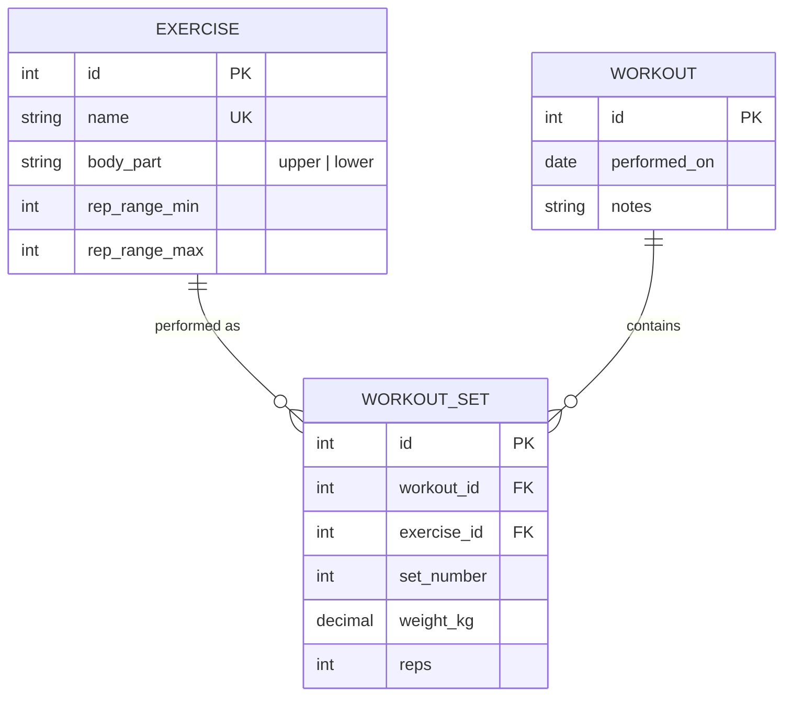
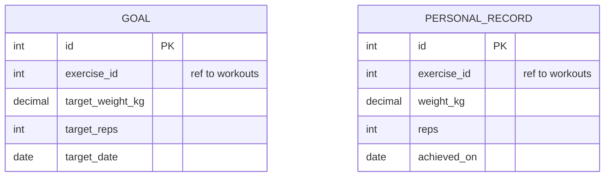

# Data model

**Must match the migrations** in `services/*/migrations/`. The skeleton has no domain
tables yet; this is the plan. Each owner updates their half in the same PR as the migration.

## workouts database

## progress database

No foreign keys to the workouts database (it is another service). `exercise_id` is a
reference by value, checked through the workouts API.

