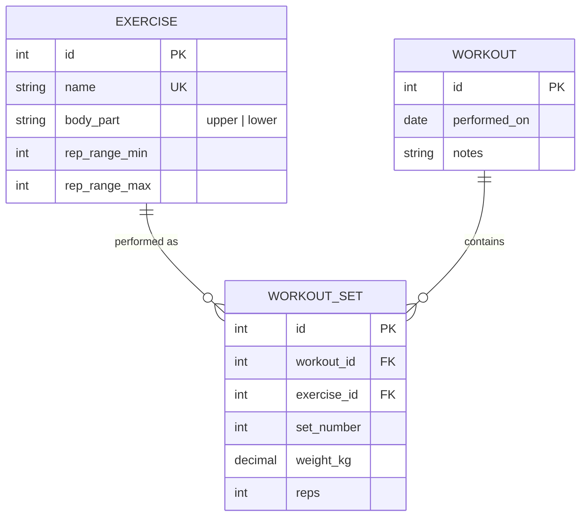
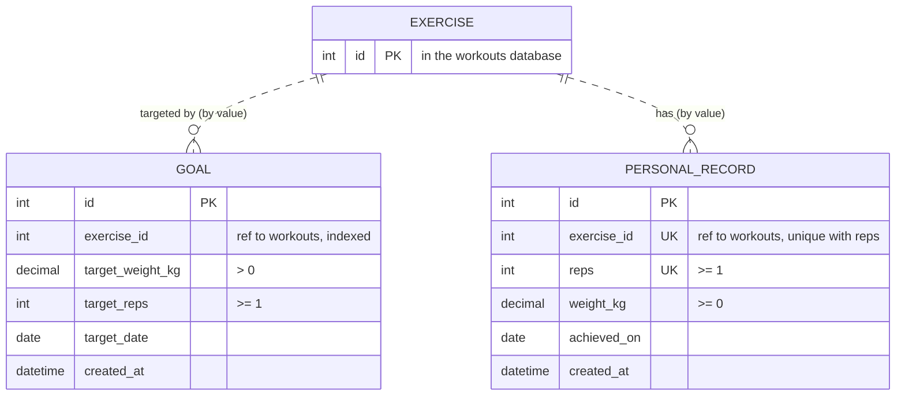

# Data model

**Must match the migrations** in `services/*/migrations/`. Each owner updates their half
in the same PR as the migration. workouts: `001_init.sql`. progress: `001_goals.sql`,
`002_personal_records.sql`.

## workouts database

Rules enforced in the database: exercise names are unique; `body_part` is `upper` or
`lower`; `1 <= rep_range_min <= rep_range_max`; `weight_kg >= 0`; `reps >= 1`;
`(workout_id, exercise_id, set_number)` is unique. Deleting a workout deletes its sets
(`ON DELETE CASCADE`); an exercise that has sets cannot be deleted. Every table also has
`created_at` (UTC). `weight_kg` is `DECIMAL(6,2)`, so 62.5 kg is stored exactly.

## progress database

No foreign keys to the workouts database (it is another service). `exercise_id` is a
reference by value, checked through the workouts API; the dotted lines below are those
references, not database constraints. `EXERCISE` is shown only to make them readable: it
lives in the workouts database.

`goals` (`001_goals.sql`): `target_weight_kg > 0` (`DECIMAL(6,2)`), `target_reps >= 1`, indexed
on `exercise_id`, plus `created_at` (UTC). A goal means "lift `target_weight_kg` for at least
`target_reps` reps by `target_date`". How close a goal is, is not stored: it is computed from the
workouts history on every request (`GET /goals/{id}/progress`).

`personal_records` (`002_personal_records.sql`): the heaviest `weight_kg` for each exact `reps`
count of an exercise, and the first day it was lifted (`achieved_on`). `(exercise_id, reps)` is
unique, `weight_kg >= 0` (`DECIMAL(6,2)`), `reps >= 1`, plus `created_at` (UTC). The rows of an
exercise are rebuilt from the workouts history each time `GET /exercises/{id}/records` is
called, so a deleted or corrected workout corrects its PRs too. They are stored so `GET /records`
can show the last known PRs while workouts is down, and so the API can mark which PRs are new.
